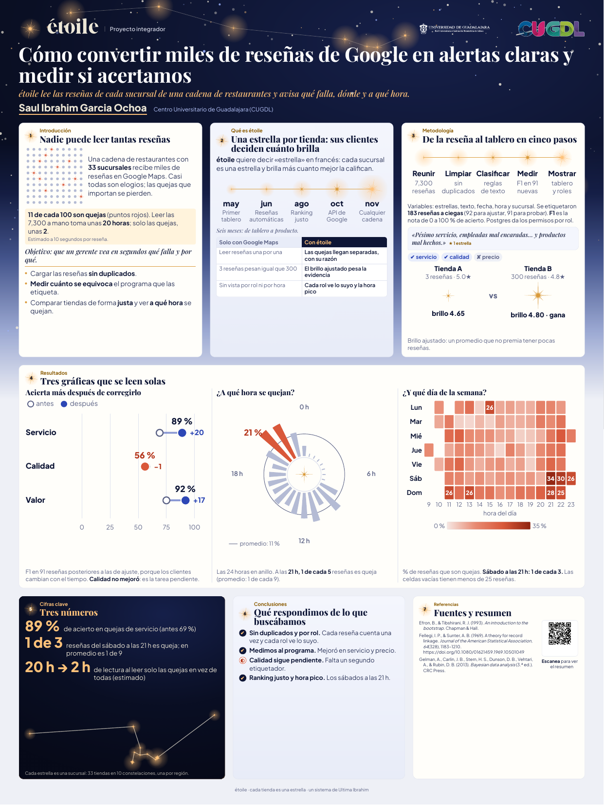

# Un número no alcanza: étoile convierte miles de reseñas en una historia clara por tienda

Póster del proyecto integrador de **Saul Ibrahim Garcia Ochoa**, Centro Universitario de Guadalajara (CUGDL).

- **Póster (90 × 120 cm):** [`poster.pdf`](poster.pdf), y con 3 mm de sangrado para imprenta: [`poster_sangrado.pdf`](poster_sangrado.pdf)
- **Vista previa:** [`vista_previa.png`](vista_previa.png)

## Qué es étoile
*étoile* quiere decir «estrella» en francés. Es un tablero que lee las reseñas de Google Maps de cada sucursal de una cadena y cuenta qué se critica, qué se elogia y cuándo. Cada sucursal es una estrella, cada región una constelación, y la estrella brilla más cuanto mejor la califican sus clientes.

El caso de aplicación es una cadena de restaurantes de **33 sucursales en 10 regiones**. Se presenta de forma anónima. El código de étoile es privado.

## Antes: un número y un color
En la cadena del caso, el gerente veía la calificación de Google y las reseñas más recientes. Marketing recibía un Excel de mapa de calor, de rojo a verde: un número y un color por semana. No decía por qué subía o bajaba, ni qué se criticaba o se elogiaba, ni cuántas reseñas había detrás. Las reseñas nuevas se descargaban cada 15 días; hoy llegan en una mediana de unas 3 horas.

**Objetivos**
1. Contar qué dicen las reseñas de cada tienda, no solo cuántas.
2. Ubicar cuándo se concentran las quejas en la semana.
3. Averiguar si a otras cadenas les sirve.

## Por qué un solo número no alcanza
| Dato | Fuente | Alcance |
|---|---|---|
| El 74 % solo mira reseñas de los últimos 3 meses; el 47 % no usaría un negocio con menos de 20 reseñas; el 89 % espera que el dueño responda | [BrightLocal (2026)](https://www.brightlocal.com/research/local-consumer-review-survey/) | Encuesta a consumidores de EE. UU. |
| El número de reseñas y las valoraciones positivas influyen en el posicionamiento local | [Ayuda de Google](https://support.google.com/business/answer/7091) | Documentación de Google; no da pesos ni umbrales |
| Calificación, cantidad, recencia y flujo constante de reseñas puntúan alto para el mapa de Google | [Whitespark (2026)](https://whitespark.ca/local-search-ranking-factors/) | Encuesta a 47 expertos en SEO local: opinión, no medición del algoritmo |

**Cautela.** Es evidencia de EE. UU. Un estudio de 2011 sobre Yelp ([Luca, 2011](https://econpapers.repec.org/RePEc:hbs:wpaper:12-016)) halló más ingresos por estrella en restaurantes independientes y un efecto casi nulo en cadenas. No sabemos si hoy se cumple, ni en México. No encontramos datos públicos mexicanos sobre cómo las cadenas usan las reseñas.

## Metodología
- **Variables:** estrellas, texto, fecha, hora local y sucursal.
- **Muestra:** 7,310 reseñas con texto de 33 sucursales y 10 regiones (al corte del póster).
- **Queja:** reseña de 1 o 2 estrellas con texto.
- **Hora:** cada reseña se cuenta en la zona horaria de su región.
- **Equipo:** Postgres (Supabase), JavaScript y ECharts.
- **Análisis:** proporciones de quejas por hora y por día de la semana.
- **Temas:** las etiquetas de tema (servicio, calidad, precio) salen de reglas de palabras en español, no de IA. Su exactitud aún no se mide de forma continua.
- **Brillo ajustado:** para comparar tiendas con distinto número de reseñas se mezcla el promedio de la tienda con el de su región: `(n · promedio + 10 · C) / (n + 10)`, donde `n` es el número de reseñas y `C` el promedio regional. Una tienda con 3 reseñas de 5★ no le gana a una con 300 reseñas de 4.8★. En el póster, las tiendas A y B son imaginarias.

## Resultados
- **11 de cada 100** reseñas con texto son quejas (832 de 7,310).
- **Hora:** a las 21 h, 1 de cada 5 reseñas es queja; el promedio es 1 de cada 9.
- **Día:** los sábados a las 21 h, 1 de cada 3 reseñas es queja (27 de 82). Es una sola celda del mapa de calor y la muestra es pequeña; las celdas con menos de 25 reseñas se dejan vacías.
- **Frescura:** las reseñas nuevas llegan en una mediana de unas 3 horas. Antes, cada 15 días.

## Limpieza de datos y aprendizaje automático
En [`analitica/`](analitica/) están los scripts de Python que limpian las reseñas y aplican ML sobre ellas:
- **Limpieza** ([`01_limpieza.py`](analitica/01_limpieza.py)): validación, hora local, normalización de texto, idioma, duplicados, anonimización. Embudo en [`reporte_limpieza.md`](analitica/resultados/reporte_limpieza.md).
- **Clasificador supervisado** ([`02_modelo.py`](analitica/02_modelo.py)): ¿la reseña es negativa (1–2★) por su texto? TF-IDF con Naive Bayes y regresión logística (F1 ≈ 0.91) contra las reglas de palabras de étoile (F1 ≈ 0.76). Ver [`reporte_modelo.md`](analitica/resultados/reporte_modelo.md).
- **¿De qué se queja?** ([`04_evaluacion_categorias.py`](analitica/04_evaluacion_categorias.py)): las reglas de temas de étoile contra 183 reseñas etiquetadas, con intervalos de confianza. Servicio F1 ≈ 0.86, calidad ≈ 0.59. Ver [`reporte_categorias.md`](analitica/resultados/reporte_categorias.md).
- **Agrupamiento** ([`03_clusters.py`](analitica/03_clusters.py)): K-means sobre el perfil reciente de las sucursales: separa 6 de 33 con más quejas (exploratorio). Ver [`reporte_clusters.md`](analitica/resultados/reporte_clusters.md).

## Lo que sabemos y lo que no
- Un número no alcanza: Google y los consumidores miran cantidad, recencia y respuesta (evidencia de EE. UU.).
- étoile separa las quejas y muestra cuándo se concentran.
- **No sabemos** cómo usan las reseñas las cadenas mexicanas. No hay datos públicos.
- **Siguiente paso:** probar étoile con otras cadenas y preguntarles.

## Limitaciones
- Es un caso, una sola cadena.
- La hora de una reseña es la de su publicación, no la de la visita.
- Las cifras de los estudios externos no son de México.
- Las etiquetas de tema son reglas y su exactitud no se mide de forma continua.

## Referencias
- BrightLocal. (2026, 11 de febrero). *Local consumer review survey 2026*. https://www.brightlocal.com/research/local-consumer-review-survey/
- Google. (s. f.). *Consejos para mejorar el posicionamiento local en Google*. Ayuda de Perfil de Empresa. https://support.google.com/business/answer/7091
- Luca, M. (2011). *Reviews, reputation, and revenue: The case of Yelp.com* (Working Paper 12-016). Harvard Business School.
- Whitespark. (2025, 6 de noviembre). *Local search ranking factors 2026*. https://whitespark.ca/local-search-ranking-factors/
